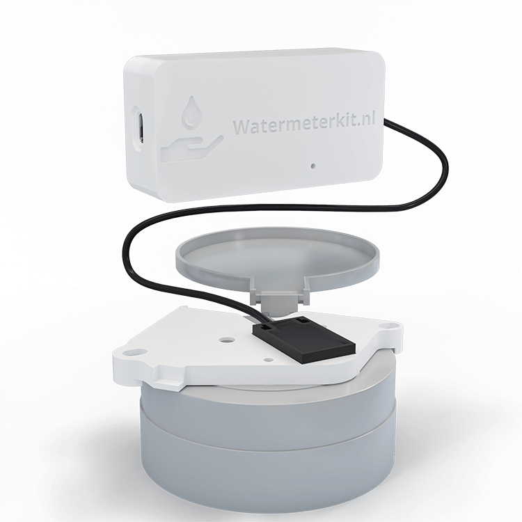
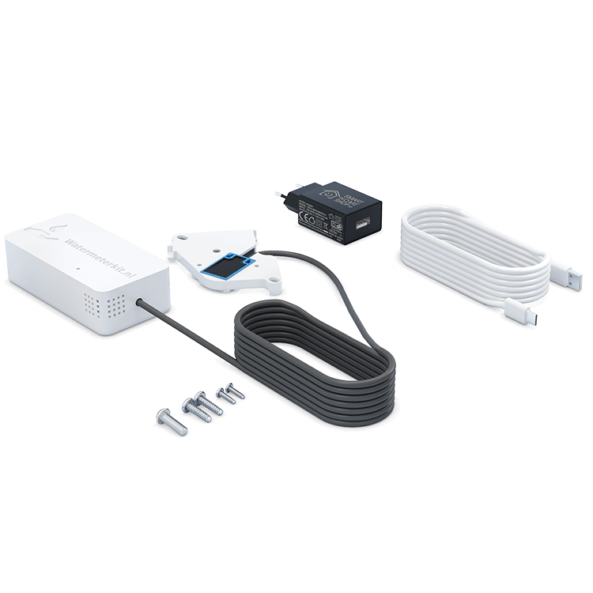

# WaterMeterKit for Home Assistant / ESPHome



WaterMeterKit is a compact ESPHome-based water meter sensor for Home Assistant. It measures real-time water usage from compatible analog water meters and is designed for fully local operation without cloud dependencies.

Product page: https://watermeterkit.nl/en

## How It Works

The WaterMeterKit uses a magnetic sensor to detect the rotating element on your analog water meter, counting each liter that passes through. Compatible with most major water meter brands including Actaris, Elster, Honeywell, Itron, Sensus and more.

Compatibility guide: https://watermeterkit.nl/en

## Key Features

- Real-time water usage tracking with pulse meter sensing
- Temperature and humidity sensing with HDC1080
- WiFi onboarding with captive portal fallback
- Fully local operation with Home Assistant and ESPHome

## Hardware Versions

| Version | Chip | Connectivity | Description |
|---------|------|--------------|-------------|
| V2 | ESP8266 | WiFi | Current ESP8266 hardware revision for analog water meters |
| V3 | ESP32-C6 | WiFi, Cloud or Thread | Latest hardware revision with ESP32-C6 |

## Variants

We publish one customer-facing firmware variant per hardware revision.

| Hardware | Variant | Description |
|----------|---------|-------------|
| V2 (ESP8266) | WiFi | Standard WiFi firmware with captive portal and Improv Serial |
| V3 (ESP32-C6) | WiFi | Standard local WiFi firmware for the ESP32-C6 platform |
| V3 (ESP32-C6) | Cloud | WiFi firmware with optional SmartHomeShop Cloud support |
| V3 (ESP32-C6) | Thread | Local Thread firmware for an existing Thread network |

## Getting Started

1. Install the WaterMeterKit on your water meter.
2. Flash the WiFi/Cloud firmware with the web flasher or ESPHome CLI.
3. If WiFi is not configured yet, connect to the fallback hotspot.
4. On V2 hardware, you can also use Improv Serial over USB for wired provisioning.

Web flasher: https://smarthomeshop.io/en/firmware
Quick start guide: https://smarthomeshop.io/quick-start-watermeterkit

## OTA Note

If you see the error `ESP does not have enough space to store OTA file`, that applies to the ESP8266-based V2 hardware because of its 1MB flash limitations.

For recovery or reflashing, use the USB web flasher:
- Connect the WaterMeterKit via USB-C
- Open https://smarthomeshop.io/en/firmware
- Select WaterMeterKit and flash the latest firmware

## Version History

- Customer-facing release notes: [CHANGELOG.md](CHANGELOG.md)
- GitHub Releases: https://github.com/smarthomeshop/watermeterkit/releases

## Repository Layout

```text
watermeterkit/
├── watermeterkit-v1/       # Legacy V1 naming kept for backwards compatibility
├── watermeterkit-v2/       # V2 ESP8266 ESPHome configurations
├── watermeterkit-v3/       # V3 ESP32-C6 ESPHome configurations
├── CHANGELOG.md            # Customer-facing firmware notes
└── images/
```

## Firmware Downloads

Pre-built firmware manifests are published on the `gh-pages` branch.

- V2 WiFi: `watermeterkit-v2-manifest.json`
- V3 WiFi: `watermeterkit-v3-manifest.json`
- V3 Cloud: `watermeterkit-v3-cloud-manifest.json`

Thread firmware is not published as a universal binary because the Thread Active dataset belongs to each user's network. Use the V3 Thread package in ESPHome and install it over USB.

## Sensors

| Sensor | Description |
|--------|-------------|
| Current Usage | Water flow rate in L/min |
| Total Consumption | Cumulative water usage in m³ |
| Water Meter Initial Value | Configurable starting point that matches the physical meter |
| Water Meter Total | Absolute water meter reading that survives reboots and OTA updates |
| Temperature | Environment temperature |
| Humidity | Environment humidity |
| WiFi Signal | WiFi signal strength |
| Uptime | Device uptime |

## Water Meter Total

WaterMeterKit V1, V2 and V3 store an absolute water meter total so the reading survives reboots and firmware updates.

1. Read the current value on your physical water meter.
2. Enter that value in `Water Meter Initial Value` in Home Assistant.
3. Use `Water Meter Total` as the absolute meter reading going forward.

All versions use the same checkpoint logic in
[`packages/water-persistence.yaml`](packages/water-persistence.yaml). A changed
meter reading is saved even when less than 50 litres have been used. The default
`water_checkpoint_interval` is five minutes on V3 (ESP32-C6) and thirty minutes
on V1/V2 (ESP8266). The longer ESP8266 interval limits wear because its
preferences backend erases a single flash sector per changed sync, while ESP32
uses NVS wear levelling. These intervals do not constitute a flash lifespan
guarantee; lifetime depends on the flash chip and workload.

No new pulses means no water checkpoint write. Calibration and clean restarts/OTA
flush the latest reading immediately. Each water checkpoint also flushes other
queued preferences. Existing global IDs/types and entity names are retained.
The raw `Total Consumption` counter still starts at zero after a reboot; use
`Water Meter Total` for the calibrated absolute reading.

Sudden power loss or a crash can lose usage since the last successful checkpoint
(normally up to five minutes on V3 or thirty minutes on V1/V2). Pulses during
downtime cannot be counted. `water_checkpoint_interval` can be overridden, with
a tradeoff between possible lost usage and flash wear. A normal API reconnect
does not reset the counter. The existing two-minute flow timeout is unchanged;
Home Assistant session-volume and daily-usage corrections belong in the
integration.

Run the storage regression checks with `python3 -m unittest discover -s tests`.
They compile and execute the actual checkpoint, calibration and meter-reading
lambdas using a local C++ compiler; no connected meter is required.

## Local firmware checks

With Python 3 and Docker Desktop running, use the pinned ESPHome 2026.7.3
container. This builds V1/V2 ESP8266 firmware on Apple Silicon without installing
Rosetta. No local ESPHome installation or secrets file is needed.

```sh
# Run the water storage regression tests inside Docker.
python3 tools/check-firmware.py test

# Test the storage logic, validate every entrypoint and generate its C++.
python3 tools/check-firmware.py validate

# Test and compile V3 local firmware (the default build).
python3 tools/check-firmware.py build

# Compile V1/V2 variants; multiple entrypoints run in sequence.
python3 tools/check-firmware.py build watermeterkit-v1/watermeterkit.yaml watermeterkit-v2/watermeterkit.yaml

# Check the largest V3 cloud variant with API encryption.
python3 tools/check-firmware.py build watermeterkit-v3/tests/api-encryption-size.yaml
```

The same commands are available in the neighbouring `waterp1meterkit` repository.
The script reads the current local YAML, stages a copy with dummy credentials
and a dummy Thread dataset, and keeps logs, a JSON report and compiled binaries
under the ignored `.local-build/` directory. Developers' `secrets.yaml` files
are not copied. Test binaries contain dummy credentials and are not intended for
flashing; device tests require a separate build with the device's configuration.
Generated sources and compiler caches live in the local temporary directory
(to avoid Docker file-lock errors in Documents/iCloud folders). The first run
needs internet to download the container, toolchains and remote packages.
Subsequent builds reuse the caches.

## Contributing

PRs and issues are welcome. Please keep changes modular and follow ESPHome best practices.

## Support

- Product info and guides: https://watermeterkit.nl/en
- Store: https://smarthomeshop.io
- Community and support: https://smarthomeshop.io/discord

## License

This project is released under the CC BY-NC 4.0 license.



